# Frontend E2E & Usability QA — Sprint 10 D2.5

**Ngày kiểm tra:** 21/11/2026  
**Phạm vi:** Streamlit prototype, kiểm tra thủ công qua chế độ Demo (mock).  
**Nguồn bằng chứng:** Ảnh chụp được cung cấp trong `Test streamlit.docx`, lưu tại [`screenshots/`](screenshots/).

## Cách chạy

```powershell
streamlit run frontend/streamlit_app.py
```

Chọn **Demo (mock)** ở sidebar và gửi các prompt/marker như bảng bên dưới. Kết quả là dữ liệu giả lập để kiểm tra UI; không phải kết quả tư vấn pháp lý.

## Kết quả kiểm tra

| ID | Tình huống | Prompt / thao tác | Kết quả quan sát | Trạng thái |
|---|---|---|---|---|
| D2.5-01 | Legal answer PASS | `Hãy hỏi về một quy định pháp luật` | UI hiện câu trả lời giả lập, `SUCCESS`, `LEGAL_IN_SCOPE`, `PASS`, citation `[1]` và Evidence Panel. | PASS (mock) |
| D2.5-02 | Non-legal | `Xin chào` | UI hiện `SUCCESS`, route `NON_LEGAL`, grounding `NOT_RUN`; không có citation và panel báo không có căn cứ trích dẫn. | PASS (mock) |
| D2.5-03 | Clarification | `[mock:clarify]` | Hiện nội dung làm rõ, `NEEDS_CLARIFICATION`; không hiển thị answer. | PASS (mock) |
| D2.5-04 | Abstention | `[mock:abstain]` | Hiện thông báo từ chối, không hiển thị answer. | PASS (mock) |
| D2.5-05 | Grounding Gate FAIL | `[mock:gate_fail]` | Hiện `ABSTAIN`, grounding `FAIL` và thông báo từ chối; không hiển thị draft answer. | PASS (mock) |
| D2.5-06 | API timeout dạng response lỗi | `[mock:timeout]` | UI hiển thị trạng thái `ERROR` và nội dung lỗi từ response giả lập. | PASS (mock response) |
| D2.5-07 | Date picker | Bật **Tự chọn ngày tra cứu** | Date picker mở và cho chọn ngày. | PASS (manual) |
| D2.5-08 | Ngày do người dùng chọn | Chọn `2026-11-05`, gửi câu hỏi tiếng Việt | Response hiển thị `2026-11-05` và nguồn ngày “ngày bạn chọn”; Evidence Panel nhận ngày từ response. | PASS (mock) |
| D2.5-09 | Nhiều evidence/citation | `[mock:many_evidence]` | UI hiển thị ba citation `[1]`, `[2]`, `[3]` và ba evidence tương ứng. | PASS (mock) |
| D2.5-10 | Evidence dài | `[mock:long_evidence]` | Phần nội dung dài có vùng cuộn riêng trong Evidence Panel. | PASS (mock) |
| D2.5-11 | Không citation | `Xin chào` | Evidence Panel hiện “Không có căn cứ trích dẫn.” | PASS (mock) |
| D2.5-12 | Tiếng Việt và disclaimer | Các tình huống trên | Nội dung tiếng Việt có dấu hiển thị; disclaimer xuất hiện trong các response chụp được. | PASS (mock) |
| D2.5-13 | Legal ngoài phạm vi | `[mock:out_of_scope]` | UI hiện `ABSTAIN`, route `LEGAL_OUT_OF_SCOPE`, grounding `NOT_RUN`, không có answer/citation. Contract cũng được kiểm tra bằng unit test. | PASS (mock UI + unit test) |
| D2.5-14 | Transport timeout | `[mock:network_timeout]`; API client được mock ném `requests.Timeout` | UI hiện thông báo timeout thân thiện; unit test xác nhận API client chuyển tiếp timeout exception và timeout value. | PASS (mock UI + unit test) |

**Kết quả test tự động:** `python -m pytest -q test/frontend/test_api_client.py test/frontend/test_mock_api.py` → **9 passed**. Pytest có một cảnh báo cache directory đã tồn tại; các test vẫn hoàn tất thành công.

### Bằng chứng tự động cho hai case bổ sung

| Test | Bằng chứng được assert | File |
|---|---|---|
| `test_out_of_scope_mock_returns_abstention_without_answer` | `status=ABSTAIN`, `route=LEGAL_OUT_OF_SCOPE`, `grounding_status=NOT_RUN`, `answer=null`, `citations=[]`. | [`test_mock_api.py`](../../test/frontend/test_mock_api.py) |
| `test_network_timeout_marker_raises_requests_timeout` | `[mock:network_timeout]` phát sinh `requests.Timeout` thay vì trả payload `ERROR`. | [`test_mock_api.py`](../../test/frontend/test_mock_api.py) |
| `test_ask_propagates_transport_timeout_for_ui_to_handle` | API client truyền cấu hình `timeout=1` vào request và không nuốt `requests.Timeout`, để lớp UI hiển thị thông báo thân thiện. | [`test_api_client.py`](../../test/frontend/test_api_client.py) |

## Ảnh chụp

### Trạng thái ứng dụng và câu trả lời

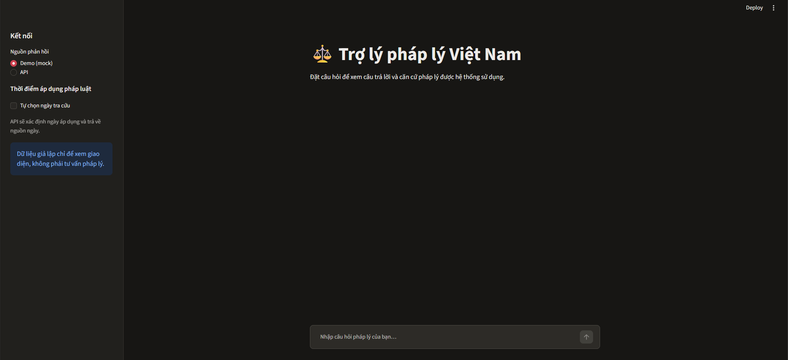

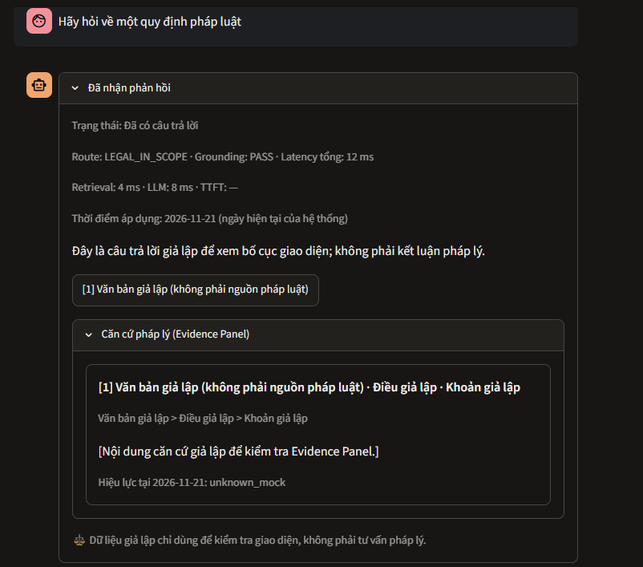

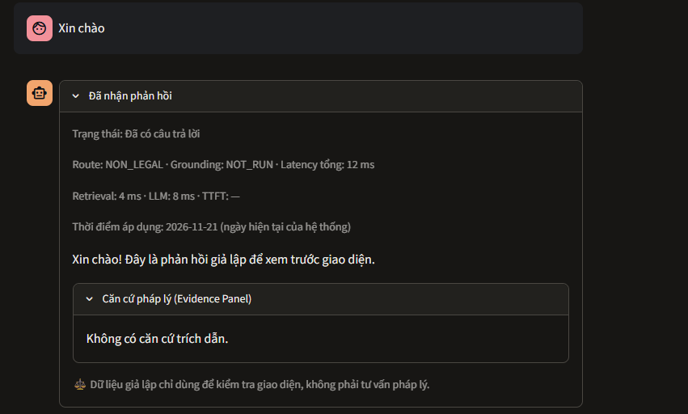

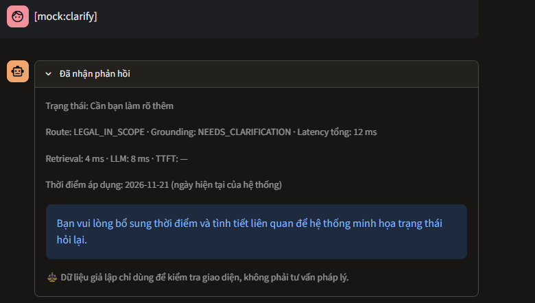

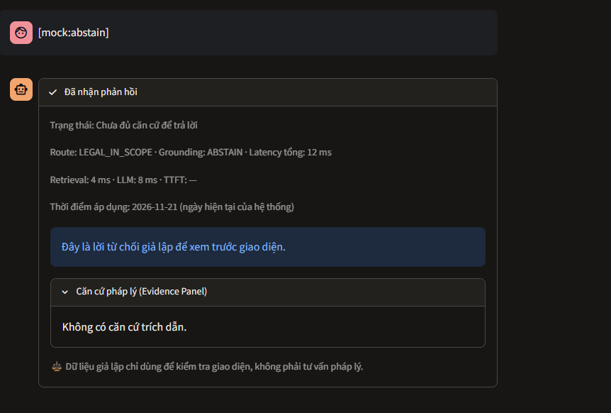

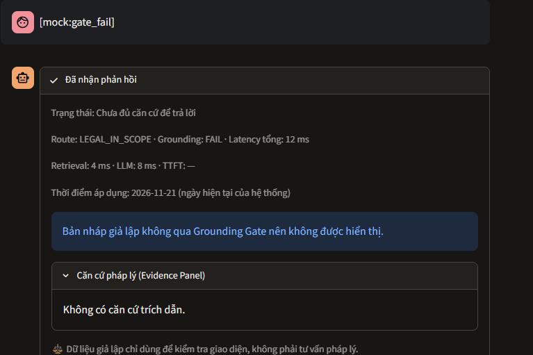

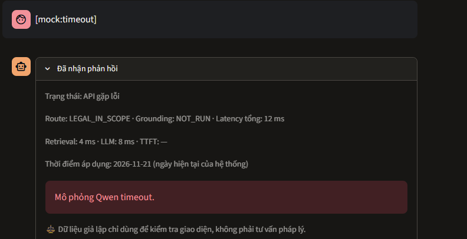

### Date picker và Evidence Panel

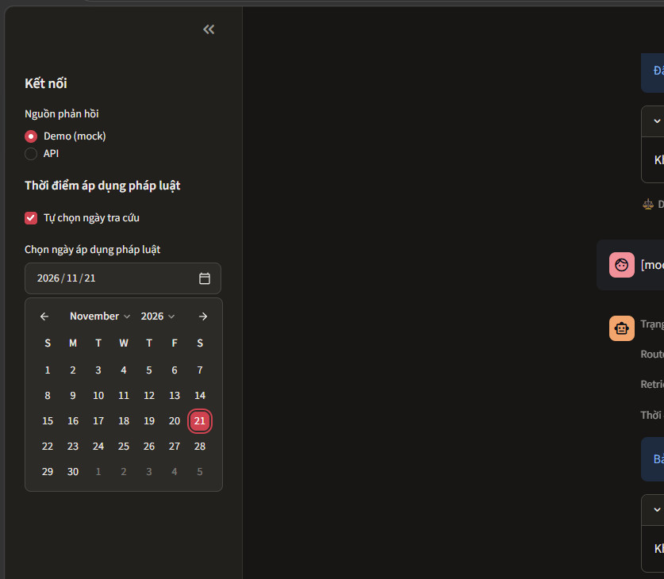

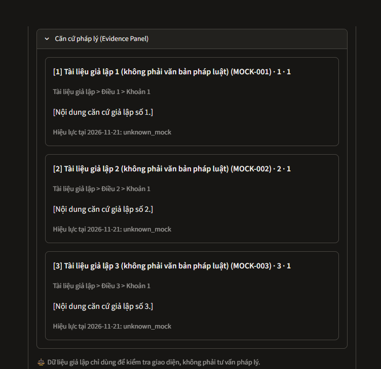

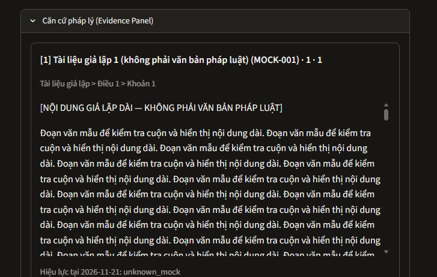

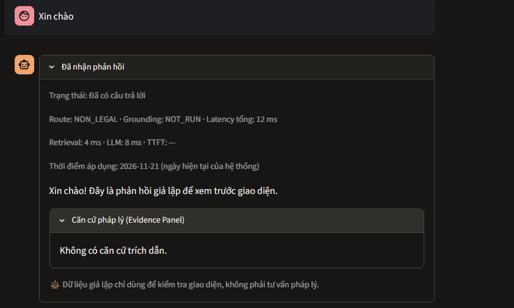

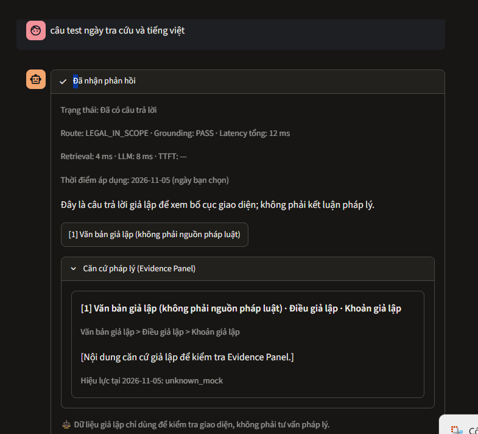

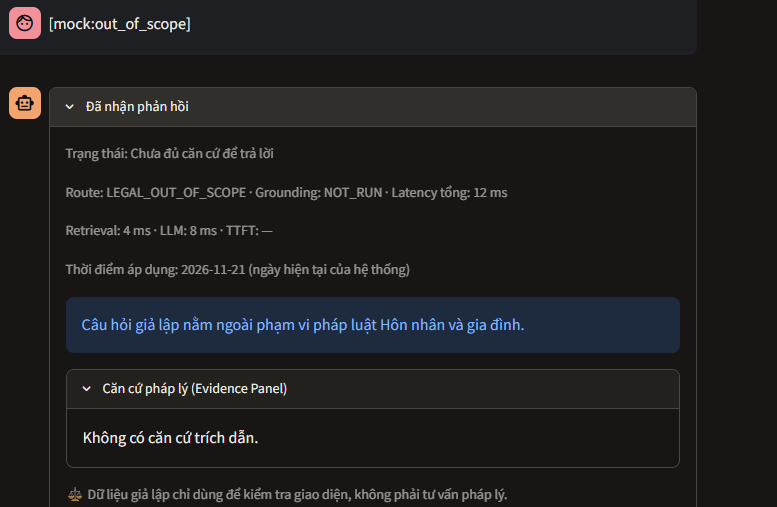

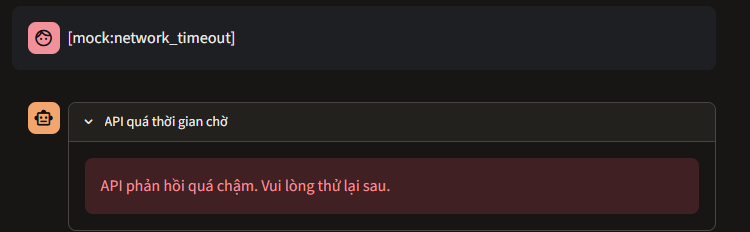

## Giới hạn và việc cần xác nhận khi tích hợp API

- Các ảnh và kết quả trên đều thuộc **Demo (mock)**; chưa phải E2E với FastAPI hoặc dữ liệu luật thật.
- `[mock:timeout]` trả về response `ERROR`; `[mock:network_timeout]` ném `requests.Timeout` và ảnh xác nhận UI hiển thị thông báo thân thiện. Chưa thử một HTTP server thật cố tình phản hồi chậm.
- Route `LEGAL_OUT_OF_SCOPE` có fixture, unit test và ảnh UI; chưa kiểm tra với Router thật.
- Ảnh nhiều evidence xác nhận ba mục được render; chưa có ảnh chứng minh thao tác bấm `[2]` làm nổi bật đúng căn cứ thứ hai.
- Ngày được chọn xác nhận việc truyền/hiển thị ngày trong mock; không xác nhận tính đúng đắn pháp lý của hiệu lực văn bản. Corpus hiện có thể không bao phủ toàn bộ các ngày trong date picker.
- Tài liệu `Test streamlit.docx` không có kết quả pytest hoặc lần gọi API thật; các unit test bổ sung nêu trên đã chạy cục bộ, nhưng chưa có E2E với API thật.

## Tóm tắt

Các trạng thái UI, disclaimer, không citation, ba evidence, vùng cuộn evidence dài, route ngoài phạm vi và thông báo timeout đã được quan sát hoạt động với mock. D2.5 vẫn cần một vòng kiểm tra với API tích hợp để xác nhận route thực, timeout mạng thật, metadata hiệu lực và dữ liệu evidence thực tế.
